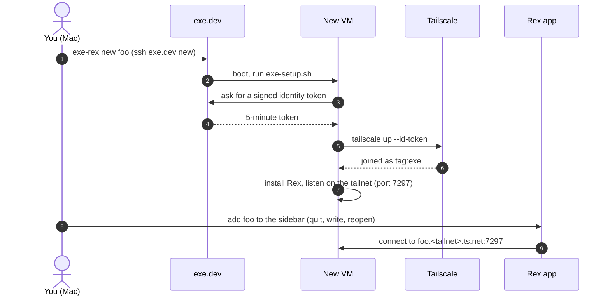

# exe.dev VMs as Rex remote hosts

Create an [exe.dev](https://exe.dev) VM and it shows up in the [Rex](https://superlogical.com) Mac app's sidebar about 10 seconds later, with no auth keys to copy and no dialog to fill in. One more command removes it from Rex, your tailnet and exe.dev.

```bash
exe-rex new scratch   # create it, join it to your tailnet, start Rex, add it to the sidebar
exe-rex rm scratch    # remove it everywhere
```

Tested November 2026 with Rex Beta 0.1.0 (build 1758) on macOS and exe.dev's `exeuntu` image (Ubuntu 24.04).

> **Using a coding agent?** Ask it to *"set up exe.dev VMs as Rex remote hosts by following AGENTS.md in https://github.com/ethanolivertroy/exe-dev-rex"*. [`AGENTS.md`](AGENTS.md) has a check after every step. You paste the one Tailscale token yourself; the agent never sees it.

## Install

You need a Mac with the Rex app and its `rex` CLI, Tailscale, and an exe.dev account (`ssh exe.dev` works).

```bash
curl -fsSL https://github.com/ethanolivertroy/exe-dev-rex/releases/latest/download/exe-rex-darwin-arm64.tar.gz | tar xz
./exe-rex install
```

On an Intel Mac, use `exe-rex-darwin-amd64.tar.gz`.

The installer puts `exe-rex` in `~/.local/bin` and sets up Tailscale and exe.dev so new VMs can join your tailnet. It asks before each change (`--dry-run` only shows them). It needs a Tailscale API access token once (**Settings → Keys → Generate access token**), which it keeps in memory only; revoke it afterwards.

Run `exe-rex doctor` any time to check the setup. To update, download the new release and run `./exe-rex install` again. To build from source or set things up by hand, see [docs/details.md](docs/details.md#build-from-source).

## Use

| | |
|---|---|
| `exe-rex` | The TUI: a setup wizard the first time, then a live table of your VMs. `n` new, `d` delete, `enter` details, `s` ssh, `c` settings, `h` health check, `q` quit |
| `exe-rex new <name>` | Create a VM. Extra arguments go to `ssh exe.dev new`, such as `--cpu=4` |
| `exe-rex rm <name>` | Delete a VM, its Tailscale device and its Rex host |
| `exe-rex ls` | Your VMs and whether Rex can reach them |
| `exe-rex doctor` | Check every piece |
| `exe-rex config` | Settings (see below) |

`new` and `rm` quit and reopen the Rex app to update its sidebar. Your sessions survive.

### VM size in the TUI

Press `n` to create a VM. CPU, memory and disk each have their own page with
accepted formats, examples and validation. CPU takes a positive whole number;
memory and disk accept whole sizes such as `4`, `4GB`, `8G` or `512MB` (bare
numbers mean GB). Blank fields use exe.dev defaults. Saved defaults from `c`
(Settings) prefill the form; clearing one really uses the service default.

The form refreshes your plan with `ssh exe.dev billing plan --json`, shows
shared account capacity, and checks reported CPU, memory and disk limits.
Included disk is shown separately from the disk ceiling: extra disk may incur
charges. Account totals are not remaining capacity; exe.dev checks actual
availability at creation. If plan lookup fails, the form says so and leaves
capacity validation to exe.dev. A final review shows the requested size before
`y` creates the VM and restarts Rex.

## Ephemeral or persistent nodes

By default, VMs join as **ephemeral** Tailscale nodes. The trust credential then only needs to create auth keys, and a VM's device disappears when you `rm` it, or within an hour if it's deleted some other way. The trade-off: a VM that's off the tailnet for 30–60 minutes or more rejoins by itself when it comes back, and that restarts Rex there, **stopping programs running in its sessions**.

If you pause VMs with long-running jobs, install with `--persistent`. Nodes then stay while the VM is off, but `exe-rex rm` has to delete them through the Tailscale API, which needs the `devices:core` scope. **That scope lets any process on any of your exe.dev VMs remove, expire or retag any machine on your tailnet.** Add `--auth-keys-only` to keep persistent nodes without it and delete devices in the Tailscale console yourself.

## Settings

Mac-side choices live in `~/.config/exe-rex/config.toml`. The installer writes them; `exe-rex config` shows them.

```toml
[new]          # defaults for ssh exe.dev new
cpu = 4
memory = "8GB"
```

```bash
exe-rex config set new.memory 16GB
exe-rex new big-one --cpu=8    # arguments beat the config
```

The VM tag, node type and credential scopes live in exe.dev and Tailscale instead, so every Mac you use sees the same setup.

## Scripting with `--json`

`ls`, `new`, `rm`, `install`, `doctor`, `config` and `version` take `--json`. They print one JSON object on stdout, always with `"ok"`, send progress to stderr, and never ask a question. That means `rm` needs `-y`, `install` needs `--yes` or `--dry-run`, and a Tailscale token must come from `TS_API_KEY`. Failures print `{"ok": false, "error": "..."}` and exit 1, or 2 for bad arguments.

```bash
exe-rex ls --json | jq -r '.vms[] | "\(.name) \(.rex)"'
exe-rex new --json scratch 2>/dev/null | jq -r .endpoint
exe-rex rm --json -y scratch | jq .tailscale     # "logged-out"
```

| Command | Fields besides `ok` |
|---|---|
| `ls` | `vms[]` (`name`, `rex`, `link`, `node`, `created_at`, `endpoint`, `ssh`, `https_url`, `paused`), `tag`, `ephemeral`, `tailnet`, `other_vms`, `warnings` |
| `new` | `name`, `endpoint`, `sidebar_label`, `https_url`, `ssh`, `seconds`, `steps[]` |
| `rm` | `name`, `tailscale` (`logged-out`, `logged-out-pending`, `deleted`, `left`), `removed_from_sidebar`, `seconds`, `steps[]` |
| `install` | `dry_run`, `needs_token`, `changes[]`, `warnings[]`, `steps[]` |
| `doctor` | `problems[]`, `warnings[]`, `checks[]` |
| `config` | `path`, `exists`, `config`, `bin_dir`, `palette`, `links` |

A step is `{"section", "status", "message"}`; status is `ok`, `todo`, `warn`, `fail` or `info`.

## How it works



1. **[Tailscale Workload Identity Federation](https://exe.dev/docs/integrations-tailscale-wif).** Each VM proves who it is with a short-lived token signed by exe.dev, and Tailscale trusts exe.dev's signature. No reusable key or secret is stored on any VM.
2. **A first-boot script.** `exe-rex new` hands each VM `exe-setup.sh` (built into the binary), which joins the tailnet and installs and runs Rex.
3. **The Rex sidebar.** The Rex app keeps its own host list that `rex hosts add` doesn't touch, so exe-rex edits it directly, carefully. This is the one part that relies on undocumented behavior: if a Rex update changes the format, exe-rex refuses to write and you add hosts with **Add Remote Host…** until it's fixed. [How it works](docs/details.md#the-rex-app-keeps-its-own-host-list).

More about timings, traces, the palette actions and the gotchas found along the way is in [docs/details.md](docs/details.md).

## Security

- No long-lived Tailscale credential exists anywhere. A VM only ever holds a 5-minute token, and by default the trust credential can only enroll `tag:exe` nodes.
- Rex on the VMs runs as the unprivileged `exedev` user and listens only on the tailnet, not on exe.dev's public HTTPS proxy.
- **Your Tailscale grant for `tag:exe:7297` decides who gets a shell** on the VMs. Rex runs with `--tailnet-allow-identified` because tagged nodes have no owner. Keep that grant to admins.

## License

[MIT](LICENSE)
