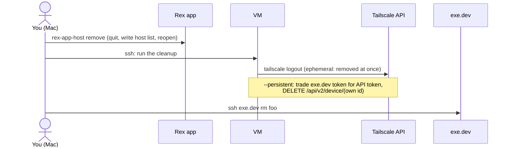

# exe-dev-rex in detail

The [README](../README.md) covers installing and using exe-rex. This page is the rest: doing the setup by hand, how each piece works, and what was learned building it.

- [Build from source](#build-from-source)
- [Manual setup](#manual-setup-without-the-installer)
- [How a run works](#how-a-run-works)
- [Command palette actions](#command-palette-actions)
- [The Rex app keeps its own host list](#the-rex-app-keeps-its-own-host-list)
- [Gotchas](#gotchas)
- [Files](#files)
- [Where Rex is heading](#where-rex-is-heading-november-2026)

## Build from source

With [Go 1.27.3 or newer](https://go.dev/dl/):

```bash
git clone https://github.com/ethanolivertroy/exe-dev-rex ~/exe-dev-rex
cd ~/exe-dev-rex
CGO_ENABLED=0 go build -trimpath -o exe-rex ./cmd/exe-rex
./exe-rex install
```

`exe-rex install` flags: `--dry-run`, `--yes` (no questions), `--persistent` and `--auth-keys-only` (node type, see the README), `--vm-tag NAME` (the exe.dev tag, default `rex-host`), `--no-palette` / `--no-links`, `--bin DIR`, and `--test` (create and delete a test VM at the end). It remembers your choices in `~/.config/exe-rex/config.toml`.

## Manual setup (without the installer)

This is what `exe-rex install` does, if you'd rather not create a Tailscale API token. Steps 1 and 3 are in the Tailscale admin console.

### 1. Tailscale policy

Add a tag for the VMs, and a rule that lets only you reach Rex on them:

```jsonc
"tagOwners": { "tag:exe": ["autogroup:admin"] },
"grants": [
  { "src": ["autogroup:admin"], "dst": ["tag:exe"], "ip": ["tcp:7297"] }
]
```

### 2. Create the exe.dev integration

```bash
ssh exe.dev integrations add wif --name tailscale-wif \
  --audience api.tailscale.com/pending --consumer tailscale --attach tag:rex-host
```

This prints an **Issuer** and a **Subject**.

### 3. Create the Tailscale trust credential

In the Tailscale admin console, go to **Settings → Trust credentials → Add → OpenID Connect**:

| Field | Value |
|---|---|
| Issuer | Custom issuer → the exe.dev Issuer |
| Subject | the exe.dev Subject, exactly as printed (no `*`) |
| Scopes | **Auth Keys: write** (lets VMs join). Add **Devices: Core: write** only for persistent nodes (lets `exe-rex rm` delete the device) |
| Tags | `tag:exe` |

Then give exe.dev the Client ID that Tailscale shows. It isn't a secret.

```bash
ssh exe.dev integrations edit tailscale-wif \
  --audience api.tailscale.com/<CLIENT_ID> \
  --metadata=client_id=<CLIENT_ID> --metadata=tags=tag:exe --metadata=ephemeral=true
```

Use `ephemeral=false` for persistent nodes.

### 4. Create VMs with the tag and the script

```bash
ssh exe.dev new --name=<vm> --tag=rex-host --setup-script=/dev/stdin < ~/exe-dev-rex/exe-setup.sh
```

To set up a VM you already have, tag it and run the script on it:

```bash
ssh exe.dev tag <vm> rex-host
ssh <vm>.exe.xyz 'bash -s' < ~/exe-dev-rex/exe-setup.sh
```

Then add it to the app with `rex-app-host add "<vm> - exe.dev" <vm>.<tailnet>.ts.net`.

## How a run works

`exe-rex rm foo` tears down in the reverse order:



A run of `exe-rex new` looks like this:

```text
 exe.dev → Rex  creating scratch

  ✓ Created the VM                     1.3s
  ✓ VM booted                          0.9s
  ✓ Joined your tailnet                3.4s
  ✓ Rex installed and running          0.8s
  ✓ Rex answers over the tailnet       0.0s
  ✓ Added to the Rex sidebar           0.9s
  ─────────────────────────────────────────
  ● scratch is ready in 9s
```

While it runs, one line redraws in place with a bar, the current step and the elapsed time. The same percentage goes to Rex through the [Program Status Protocol](https://www.superlogical.com/rex/docs/build/program-status) (OSC 7501, `app=exe-dev`), and a notification arrives when it's done or fails (if Rex's **Terminal notifications** setting is on).

`exe-setup.sh` logs `EXE-STAGE <stage> <time>` lines to `/tmp/exe-setup.log` on the VM, and `exe-rex new` reads them over SSH to know what the VM is doing. Every run leaves a trace in `~/Library/Logs/exe-dev/exe-new-<name>-<time>.log`: stage changes, every connection attempt and its error, and how the name resolved at the end. Set `EXE_NEW_TRACE=` (empty) to turn it off.

Measured on audited runs (November 2026): 1:21 with the original approach; 13s after connecting by IP and installing Rex directly (see [Gotchas](#gotchas)); 9–13s after sharing one SSH connection to exe.dev per run. The spread is how quickly Tailscale sets up a path to a brand-new VM.

`exe-rex doctor` also pings each VM and warns if Tailscale reaches it through a relay instead of directly, which makes Rex feel slower.

## Command palette actions

`rex/exe-dev.lua` adds two [custom actions](https://www.superlogical.com/rex/docs/customize/actions) to the Rex command palette, in an **exe.dev** category: `exe_new` (**New exe.dev VM…**) and `exe_rm` (**Remove exe.dev VM…**). Each opens a tab running `exe-new` or `exe-rm`, kept open afterwards so you can read the output. `exe-rex install` sets them up; by hand:

```bash
cp ~/exe-dev-rex/rex/exe-dev.lua ~/.config/rex/
echo 'require("exe-dev")' >> ~/.config/rex/init.lua
rex config check && rex config reload
```

The palette can't ask for an action's arguments yet, so the actions take an *optional* `name` and ask for one in the terminal when it's missing. (An action with a required argument would be hidden from the palette.) From the CLI or a key binding you can pass it: `rex do exe_new name=scratch`.

## The Rex app keeps its own host list

**This is the hacky part.** `rex hosts add` (and the `hosts.put` API) write to the Rex *server's* host list, but the Mac app's sidebar shows only the app's own list. That list is stored in `~/Library/Preferences/com.superlogical.rex.plist` under the key `RexSync.servers`, as JSON inside a plist `<data>` value. Syncing goes one way: hosts added in the app are copied to the server, never the other way. The app's only scriptable action, `client.host.add`, just opens the dialog.

So `rex-app-host`:

1. checks that the stored JSON looks like the format it knows (`formatVersion: 1`, records with `icon`, `id`, `lastHostID`, `lastInstanceID`, `locators`, `name`, `preferredURL`) and refuses to write otherwise
2. quits Rex, because a running Rex doesn't reload the list. The restart takes about a second, and sessions survive because they live in the separate Rex Server process.
3. backs up the old value to `~/Library/Application Support/rex/app-hosts-backups/`
4. writes the new record. `lastHostID` and `lastInstanceID` come from the host's `server.status`.
5. adds a matching copy to the server's host list (`host:<lower-case id>`), so the two lists agree
6. reopens Rex, even if a step after the quit failed

If step 5 fails, the sidebar change is kept and the error says the server's list is behind. `--no-restart` skips the quit and reopen; the change then shows the next time Rex starts. `--via ADDR` reads `server.status` from ADDR (such as `100.x.y.z:7297`) instead of resolving the endpoint.

A Rex update could change this format. If it does, `rex-app-host` stops without writing, and you use **Add Remote Host…** until it's updated.

## Gotchas

### Don't look up the VM's name before it exists

The first version polled `rex -S <name>.<tailnet>.ts.net` from the moment the VM was created. Rex on the VM was listening after 23 seconds, but the Mac's first connection arrived after 80. The likely cause is macOS caching the "no such name" answer from before the VM joined the tailnet. `exe-rex new` now waits until `tailscale status` lists the VM, connects to its tailnet IP, and passes that address to `rex-app-host --via`.

### Ubuntu has a different package called `rex`

Ubuntu's `rex` is Rexify, a Perl automation tool. If apt isn't set up to prefer Rex's repository, `apt-get install rex` installs that instead. `exe-setup.sh` checks the package maintainer (Superlogical), not just that `rex` exists.

### Installing Rex without apt's overhead

Rex's own `install.sh` runs a full `apt-get update` and `apt-get install`, about 15s on a new VM; the download and unpack take under 2s. `exe-setup.sh` writes the same apt configuration (keyring, `rex.sources`, pin), so `apt upgrade` keeps Rex updated, then installs the newest `.deb` directly. It keeps apt's chain of trust: `InRelease` checked with `gpgv`, `Packages` against the signed hash, the `.deb` against `Packages`. It runs in the background while Tailscale joins, and falls back to `install.sh` if any step fails.

### Tagged nodes have no owner, so Rex refuses them by default

Rex's `tailnet://` listener admits only the node's owner by default. A node enrolled through WIF is **tagged**: it belongs to `tag:exe`, not to you. `exe-setup.sh` therefore starts Rex with `--tailnet-allow-identified`, which makes your **Tailscale ACL the real access control**: anyone the policy lets reach `tag:exe:7297` gets a shell.

### Ephemeral nodes and rejoining

Tailscale removes an ephemeral node 30 to 60 minutes after it was last online, and at once when it logs out. A VM paused for longer loses its node; when it comes back, its `tailscaled` still says `Running`, though the tailnet no longer knows it.

`exe-setup.sh` installs `exe-rex-tailscale-rejoin.timer` for this. Every 60 seconds it checks whether the node needs to log in again, or has been offline for 3 checks in a row. If so, it joins again with a fresh exe.dev identity token under the same hostname and restarts Rex (Rex's listener is bound to the old node's address). The sidebar entry keeps working. `exe-rex rm` stops the timer before logging out, so the VM doesn't rejoin before exe.dev deletes it.

### Persistent nodes and `tailscale logout`

Logging out doesn't remove a persistent tagged device. For those, `exe-rex rm` exchanges the VM's exe.dev token for a Tailscale API token and calls `DELETE /api/v2/device/<id>` from the VM itself. That needs **Devices: Core: write**, which Tailscale's [trust credentials reference](https://tailscale.com/docs/reference/trust-credentials#scopes) says can "read the list of all devices in the tailnet, authorize or remove machines, and manipulate tags on devices". The credential's tags don't limit that. `exe-rex install` (with `TS_API_KEY`) offers to remove `devices:core` from an existing credential when you don't use `--persistent`.

### SSH to a brand-new VM

Its host key isn't in `known_hosts` yet, and `ssh -o BatchMode=yes` can't prompt, so it fails with `Host key verification failed`. Scripts that SSH to fresh VMs need `-o StrictHostKeyChecking=accept-new`.

## Files

| Path | Runs on | What it does |
|---|---|---|
| `exe-setup.sh` | the VM, at first boot | Joins the tailnet using WIF, installs Rex, runs it as a lingering systemd user service for `exedev` |
| `cmd/exe-rex` | your Mac | The `exe-rex` binary; also runs as `exe-new`, `exe-rm` and `rex-app-host` through symlinks |
| `internal/ops` | your Mac | The workflows: `new`, `rm`, `ls`, `install`, `doctor` |
| `internal/cli`, `internal/tui` | your Mac | The command line and the TUI, both driving `internal/ops` |
| `internal/exedev`, `tailnet`, `rexapp` | your Mac | exe.dev over SSH, Tailscale, and the Rex app and server |
| `rex/exe-dev.lua` | your Mac's Rex server | The command-palette actions |
| `AGENTS.md` | your coding agent | Step-by-step setup, with checks and human handoffs |

`exe-setup.sh` and `rex/exe-dev.lua` are built into the binary, so `exe-rex install` always installs matching versions.

**Why those build flags:** `go.mod` requires Go 1.27.3, the newest patched release, so older toolchains with known vulnerabilities can't build it. `CGO_ENABLED=0` links no C code (on macOS, Go still uses the system resolver, which MagicDNS needs). `-trimpath` keeps your local paths out of the binary. Check dependencies with `go run golang.org/x/vuln/cmd/govulncheck@latest ./...`.

## Where Rex is heading (November 2026)

From the Rex docs, changelog and the Rex Beta Discord, as of Rex Beta 0.1.0 (build 1758):

- **Syncing `rex hosts` to the app's sidebar is planned.** When it ships, `rex-app-host` can be replaced with `rex hosts add/remove`.
- **Palette prompts for action arguments** were requested and deferred. Until then, the palette actions ask for a name in the terminal.
- **Block plugins.** `rex server run` has `--block-dir DIR`, so a dedicated exe.dev panel may become possible once the plugin format is documented.
- **Others doing the same** (agent sandboxes, per-project VMs) hit the same sidebar limit that `rex-app-host` works around.
